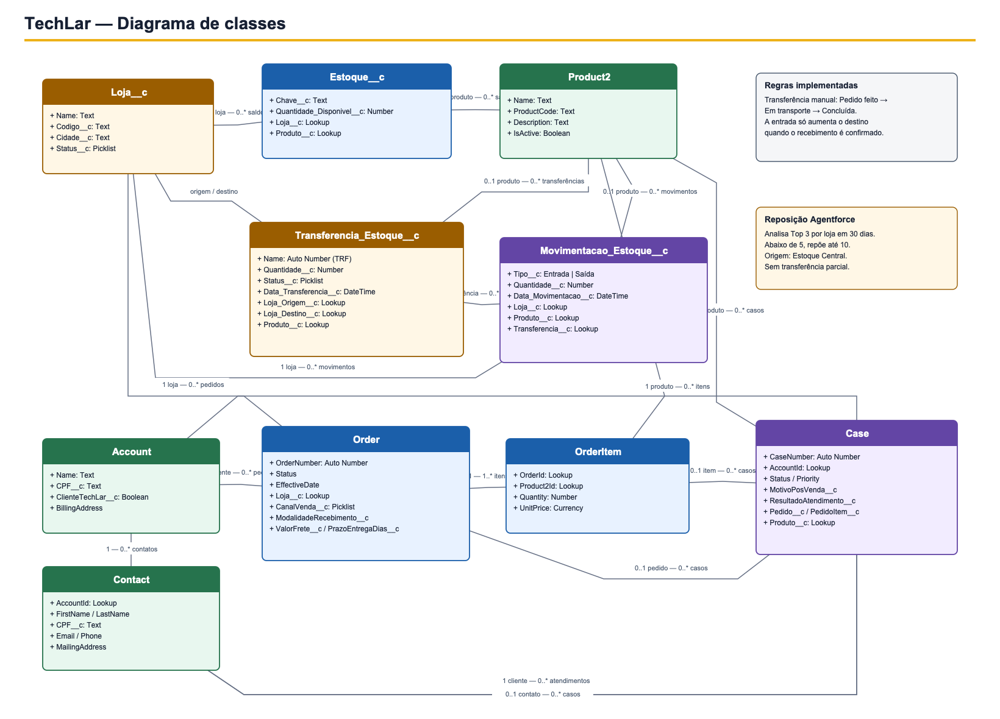
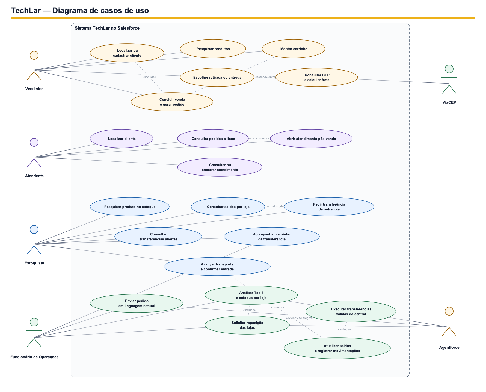

# Diagramas UML — TechLar

Os diagramas abaixo documentam o sistema implementado até a Sprint 4. Eles foram construídos a partir dos objetos, relacionamentos, classes Apex, componentes Lightning e do Employee Agent presentes no repositório.

## Diagrama de classes

O diagrama apresenta o modelo de domínio persistido no Salesforce:

- clientes são representados por `Account` e `Contact`;
- vendas geram `Order` e `OrderItem`, vinculados à loja em que foram realizadas;
- `Loja__c`, `Product2` e `Estoque__c` formam a base dos saldos por unidade;
- transferências usam `Transferencia_Estoque__c` e registram entradas e saídas em `Movimentacao_Estoque__c`;
- atendimentos pós-venda são armazenados em `Case` e podem ser relacionados ao pedido, item e produto.

[Abrir versão vetorial](diagramas/diagrama-classes-techlar.svg) · [Editar no Draw.io](diagramas/diagrama-classes-techlar.drawio)

## Diagrama de casos de uso

O diagrama reúne os fluxos efetivamente entregues nas quatro sprints:

- o vendedor cadastra ou localiza o cliente, monta o carrinho e conclui a venda;
- o atendente consulta pedidos e conduz o atendimento pós-venda;
- o estoquista consulta saldos, solicita transferências e confirma o recebimento;
- o funcionário de Operações conversa com o Agentforce para analisar os produtos mais vendidos e solicitar reposições pelo Estoque Central.

[Abrir versão vetorial](diagramas/diagrama-casos-de-uso-techlar.svg) · [Editar no Draw.io](diagramas/diagrama-casos-de-uso-techlar.drawio)

## Elementos técnicos relacionados

O front-end é composto por Lightning Web Components nas áreas de Venda Assistida, Atendimento, Estoque Geral e Operações. Os componentes chamam controladores Apex, que delegam as regras aos serviços:

- `TechLarSalesController` e `TechLarSalesService`;
- `TechLarServiceController` e `TechLarServiceService`;
- `TechLarInventoryController` e `TechLarInventoryService`;
- `TechLarAgentController`, `TechLarStockAnalysisService` e `TechLarReplenishmentService`.

No fluxo da Sprint 4, o `TechLarAgentController` mantém a sessão com o Employee Agent. O Agentforce interpreta se o funcionário deseja analisar ou repor e chama a action Apex correspondente. A reposição reutiliza o serviço de transferência de estoque e grava os saldos, a transferência e as movimentações no Salesforce.

## Arquivos editáveis

Os arquivos `.drawio` podem ser abertos no aplicativo Draw.io ou em [app.diagrams.net](https://app.diagrams.net/). As versões SVG e PNG servem para visualização no GitHub, no documento de entrega e durante a gravação do vídeo.
